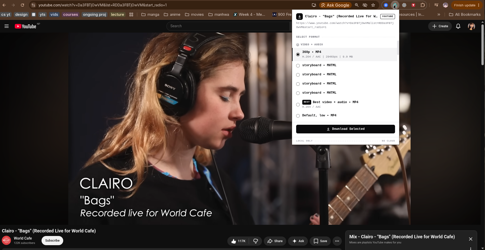

# ytdlp Downloader

Chrome extension that uses a local Python host and [yt-dlp](https://github.com/yt-dlp/yt-dlp)
to download media from the current tab. Files stay on your machine in
`~/Downloads/ytdlp-extensions/`.



## Requirements

- Linux or macOS, with Chrome or Chromium.
- Python 3.11+ and pip.
- Current yt-dlp with its recommended dependencies.
- For YouTube: a supported Deno or Node.js runtime. See the
  [YouTube setup guide](https://github.com/yt-dlp/yt-dlp/wiki/EJS).
- ffmpeg to merge separate video and audio streams.

The host detects Deno on PATH or in `~/.deno/bin`, or Node on PATH.

## Setup

```bash
git clone https://github.com/uzuw/yt-dlp-extension.git
cd yt-dlp-extension
python3 -m pip install --user -U 'yt-dlp[default]'
./install.sh
```

On distributions that block user pip installs, such as Arch Linux, use
`python3 -m pip install --user --break-system-packages -U 'yt-dlp[default]'`.

Open `chrome://extensions`, enable **Developer mode**, choose **Load unpacked**,
and select this repo's `extension/` directory. Keep the repo in place: the native
host registration points to it. Run `./install.sh` again if you move it.

## Use

Open a direct video link, click the extension, select a format, and click
**Download Selected**. Choose video + audio, video only, or audio only.
Downloads continue when the popup closes; reopen it to see progress or cancel.

Format lookup stops after 30 seconds with an error and **Retry**. A video URL
containing a playlist parameter selects only that video. Site support depends on
yt-dlp; restricted or sign-in-only media may fail.

## Updates and troubleshooting

```bash
git pull
./scripts/update-ytdlp.sh
```

Reload the extension in `chrome://extensions` after updating the repo. Failed
downloads also attempt a dependency update and retry once, with a six-hour
cooldown. Format lookup never waits for an update.

Optional weekly updates on Linux with user systemd:

```bash
./scripts/update-ytdlp.sh --install-timer
# Remove later:
./scripts/update-ytdlp.sh --uninstall-timer
```

| Problem | What to do |
| --- | --- |
| Native host missing or disconnected | Run `./install.sh`, reload the extension, and retry. |
| yt-dlp missing | Install it with the command above; check `yt-dlp --version`. |
| YouTube runtime or solver error | Install a supported Deno or Node runtime and run the update script. |
| Fetching times out or no formats appear | Try a direct video URL, check the displayed error, and update yt-dlp. Only HTTP/HTTPS pages are supported. |
| Audio/video merge fails | Check that `ffmpeg` is installed and on PATH. |

For logs, inspect the extension's **service worker** in `chrome://extensions`,
or right-click the popup and choose **Inspect**.

## Development

`extension/` contains the popup and service worker; `native-host/` runs yt-dlp
and streams progress using Chrome native messaging. There is no hosted backend.

```bash
python3 -B -m unittest discover -s tests
node tests/test_extension.cjs
```

Release history: [CHANGELOG.md](CHANGELOG.md).
