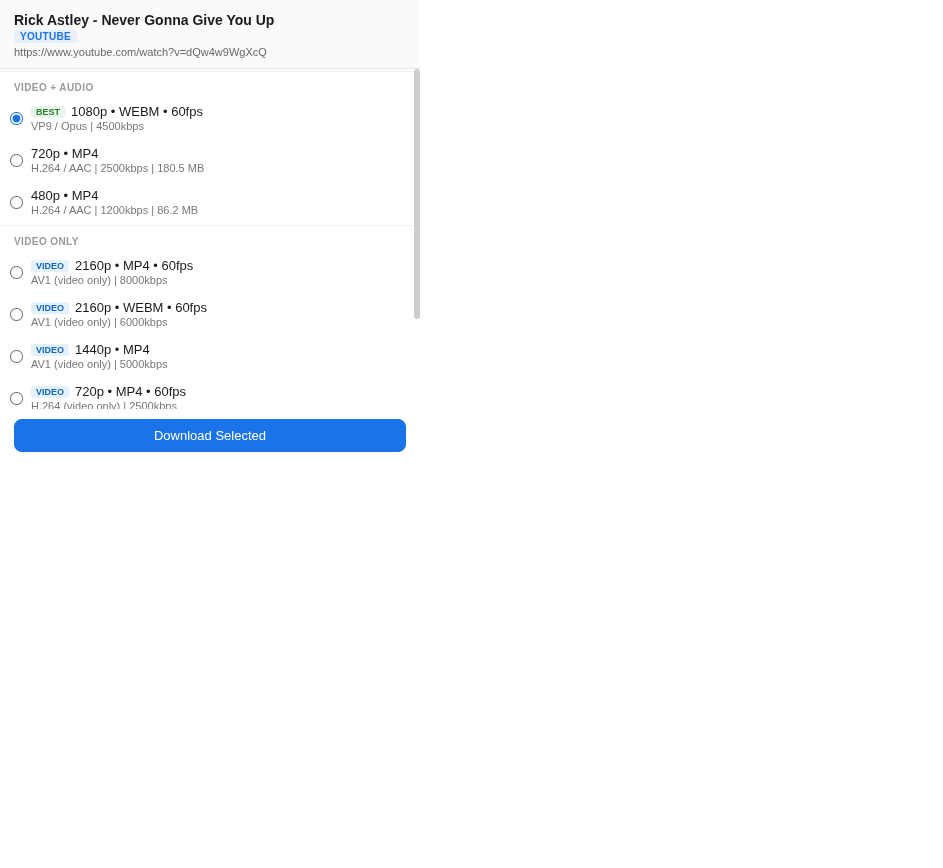

# ytdlp Downloader

[](https://github.com/yt-dlp/yt-dlp)

A Chrome extension that detects the current tab URL, fetches available formats via **yt-dlp**, and downloads media directly to your machine. No cloud, no servers, no uploads.

| Feature | Details |
|---|---|
| **Extractor** | yt-dlp — supports YouTube, Facebook, Instagram, TikTok, Twitter/X, Reddit, and 1000+ sites |
| **Architecture** | Chrome Extension (Manifest V3) + Python Native Messaging Host |
| **Download location** | `~/Downloads/ytdlp-extensions/` |
| **Format selection** | Grouped by Video+Audio, Video Only, Audio Only — pick quality, codec, and container |
| **Live progress** | Real-time download speed, ETA, and progress bar |
| **Cancel support** | Cancel mid-download without killing the host |
| **Notifications** | Chrome notification on download complete |

## Screenshot



## How it works

```
+--------+     chrome.runtime.sendMessage     +-------------+
| Popup  | ---------------------------------> | Service     |
| (HTML) | <--------------------------------- | Worker (JS) |
+--------+     forward formats/progress       +------+------+
                                                      |
                                           chrome.runtime.connectNative
                                                      |
                                              +-------v-------+
                                              | Native        |
                                              | Messaging     |
                                              | Host (Python) |
                                              +-------+-------+
                                                      |
                                              subprocess.Popen
                                                      |
                                              +-------v-------+
                                              | yt-dlp        |
                                              |  (binary)     |
                                              +---------------+
```

1. Open the popup on any page — it detects the tab URL automatically
2. The service worker sends the URL to the Python native host over stdin/stdout
3. Python calls `yt-dlp -J` to list all available formats, parses the JSON, and returns grouped formats
4. Pick a format and click **Download Selected**
5. Python spawns yt-dlp in a thread, streams progress back through the native messaging port
6. Downloads land in `~/Downloads/ytdlp-extensions/`

## Requirements

| Component | Requirement |
|---|---|
| OS | Linux or macOS |
| Chrome / Chromium | Manifest V3 compatible (Chrome 88+) |
| Python | 3.8+ |
| yt-dlp | 2023+ (install separately, see below) |
| YouTube support | Current yt-dlp with its `default` dependencies, plus Deno 2.3+ or Node.js 22+ |
| ffmpeg | Required for merging separate video and audio streams |

## Installation

### 1. Install yt-dlp

```bash
# Linux / macOS
python3 -m pip install -U 'yt-dlp[default]'

# Arch Linux (PEP 668): user-level install
python3 -m pip install --user --break-system-packages -U 'yt-dlp[default]'

# Or with a package manager
# brew install yt-dlp          # macOS
# sudo apt install yt-dlp      # Ubuntu/Debian
```

Verify it works:

```bash
yt-dlp --version
# Use the current release — YouTube breaks older releases.
```

For YouTube, also install **Deno 2.3+** or **Node.js 22+**. The host detects Deno
(including `~/.deno/bin/deno`) or enables Node from PATH automatically. The
`default` dependencies include the YouTube JavaScript challenge solver; a bare
yt-dlp installation can omit it. See the [official YouTube setup guide](https://github.com/yt-dlp/yt-dlp/wiki/EJS).
Install ffmpeg to merge video and audio when selecting **Best video + audio**.

### 2. Clone and install the native host

```bash
git clone https://github.com/uzuw/yt-dlp-extension.git
cd ytdlp-extension
chmod +x install.sh
./install.sh
```

The script will:

- Register the native messaging host in Chrome's config
- Create the output directory `~/Downloads/ytdlp-extensions/`
- Make the Python script executable
- Verify yt-dlp is available

## Keeping yt-dlp up to date

YouTube periodically changes its API, which can break older yt-dlp releases or
challenge solvers. Format detection may still work while downloads fail with HTTP 403.

When format lookup or a download fails, the native host refreshes **yt-dlp and its
recommended dependencies**, then retries once (at most one automatic refresh per
6 hours). This can repair missing dependencies even when yt-dlp itself is current.
If recovery fails, the extension shows the underlying error and update instructions.
Downloads continue reading progress through both streams and ffmpeg merging.

You can also update manually or on a schedule:

```bash
# Manual update
./scripts/update-ytdlp.sh

# Recommended on desktop Linux: weekly systemd user timer
./scripts/update-ytdlp.sh --install-timer
```

On systems without user systemd (WSL, macOS), schedule it yourself, e.g. cron:

```cron
0 3 * * 1 /path/to/ytdlp-extension/scripts/update-ytdlp.sh --quiet
```

### 3. Load the extension in Chrome

1. Open `chrome://extensions`
2. Enable **Developer mode** (top-right toggle)
3. Click **Load unpacked**
4. Select the `extension/` folder inside this repo

The extension icon should appear in your toolbar.

## Usage

1. Navigate to any supported site (YouTube, Facebook, etc.)
2. Click the extension icon in the toolbar
3. The popup shows the detected URL and fetches available formats
4. Select a format — formats are grouped by type and sorted by quality
5. Click **Download Selected**
6. Monitor progress with speed/ETA in the popup
7. Close the popup and reopen it anytime — the download continues and progress restores
8. Click **Cancel** to stop a running download

### Format groups

| Group | Description |
|---|---|
| **Video + Audio** | Combined streams (mp4, webm) with both video and audio |
| **Video Only** | High-quality video without audio (for remuxing) |
| **Audio Only** | Audio tracks in m4a, webm, opus formats |

### Tips

- The **Best** tag marks the recommended format in each group
- Video+Audio formats are ready-to-play; Video Only formats need separate audio
- Downloads continue even if you close the popup — reopen to check progress
- Check `~/Downloads/ytdlp-extensions/` for completed files

## Troubleshooting

| Problem | Check |
|---|---|
| "Native host not found" | Run `./install.sh` again. Verify the JSON file exists in `~/.config/google-chrome/NativeMessagingHosts/` |
| "yt-dlp not found" | Install yt-dlp and ensure it's on your PATH. Run `yt-dlp --version` |
| Popup shows no formats | Make sure the tab URL starts with `http://` or `https://` |
| Extension icon is grayed out | The page may not be supported by yt-dlp, or the URL is a chrome:// page |
| Download fails with "Download failed (exit 1)" | Read the underlying error. The host refreshes yt-dlp and its dependencies and retries once; if it still fails, run `./scripts/update-ytdlp.sh`, update the extension, and reload it in `chrome://extensions` |
| YouTube reports missing JS runtime or challenge solver | Install Deno 2.3+ or Node.js 22+, then run `./scripts/update-ytdlp.sh` |
| Download starts but stalls | Check the service worker console (`chrome://extensions` → service worker) |

### Debugging

- **Extension logs**: `chrome://extensions` → find ytdlp Downloader → **service worker** (inspect)
- **Popup logs**: Right-click the extension icon → **Inspect popup**
- **Native host logs**: All native host output goes to stderr — visible in the SW console when connected

## Project structure

```
ytdlp-extension/
├── extension/                    # Chrome Extension (load unpacked)
│   ├── manifest.json             # MV3 manifest with nativeMessaging permission
│   ├── background/
│   │   └── service_worker.js     # Bridges popup <-> native host, tracks download state
│   ├── popup/
│   │   ├── popup.html            # Popup UI (420px)
│   │   ├── popup.css             # Styles with grouped format display
│   │   └── popup.js              # Format fetching, progress, error handling
│   └── icons/
│       └── icon.png              # Extension icon
├── native-host/
│   ├── native_host.py            # Python NMH: list_formats, download (threaded), cancel
│   └── com.ytdlp.extension.json  # NMH registration manifest
└── install.sh                    # One-shot setup: register NMH, create output dir
```

## License

MIT
